# Documentación Técnica — De MVP a Producto Final

**Proyecto:** Sistema de gestión para gimnasio + sisrema de usuarios + inscripción a eventos
**Fecha:** 20 de noviembre de 2026
**Estado:** Documentación de arquitectura actual y diseño de la migración al producto final

---

## Índice

1. [Resumen ejecutivo](#1-resumen-ejecutivo)
2. [Estado actual: `gimnasio-mvp`](#2-estado-actual-gimnasio-mvp)
3. [Estado actual: `form-refaccionado`](#3-estado-actual-form-refaccionado)
4. [Arquitectura actual (visual)](#4-arquitectura-actual-visual)
5. [Brechas frente a los nuevos requerimientos](#5-brechas-frente-a-los-nuevos-requerimientos)
6. [Arquitectura objetivo](#6-arquitectura-objetivo)
7. [Cambios por módulo](#7-cambios-por-módulo)
8. [Tecnologías y dependencias](#8-tecnologías-y-dependencias)
9. [Patrones de diseño aplicados](#9-patrones-de-diseño-aplicados)
10. [Plan de migración de datos](#10-plan-de-migración-de-datos)
11. [Seguridad](#11-seguridad)
12. [Backups y operación](#12-backups-y-operación)
13. [Alternativas evaluadas](#13-alternativas-evaluadas)
14. [Fuera de alcance](#14-fuera-de-alcance)
15. [Apéndice: variables de entorno objetivo](#15-apéndice-variables-de-entorno-objetivo)

---

## 1. Resumen ejecutivo

Hoy existen **dos aplicaciones separadas**:

- `gimnasio-mvp`: un panel interno con **un único usuario** (la dueña), socios, cuotas, rutinas versionadas y PDF. Es un MVP presentado con éxito.
- `form-refaccionado`: un formulario público de inscripción a **un solo evento**, con un panel admin protegido por una clave secreta y backups por copia de archivo.

El pedido del negocio es convertir esto en un producto usado por **100 socios con cuenta propia** y **1 administradora (Belen)**:

- Cada socio entra con usuario y contraseña y ve **solamente lo suyo** (rutinas, datos, cuota).
- Belen administra usuarios, cargas y eventos, y ve los inscriptos.
- Los formularios de evento se integran al sistema principal, conservando la lógica de inscripción ya existente (validación de nombre/apellido/email/teléfono, cierre por fecha y plazo de cancelación).
- Se deja de depender del PDF como único entregable de la rutina.

La decisión arquitectónica recomendada es **unificar todo en una sola aplicación** sobre un **VPS propio con NGINX + PostgreSQL**, con autenticación propia basada en sesiones en base de datos, y backups cifrados en storage externo. Esta opción es la que permite cumplir la mensualidad objetivo de **$105.000 ARS** con margen para mantenimiento, a diferencia de un stack 100% serverless (Vercel + Supabase), donde la infra se come casi toda la factura.

---

## 2. Estado actual: `gimnasio-mvp`

### 2.1 Stack y estructura

```
gimnasio-mvp/
├── migrations/001_init.sql          Esquema SQLite inicial
├── scripts/
│   ├── migrate.ts                   Aplica migraciones
│   ├── seed.ts                      Carga planes y catálogo de ejercicios
│   ├── hash-password.ts             Genera hash scrypt de la clave del dueño
│   └── generate-migrations.mjs      Embebe SQL en el bundle
├── src/
│   ├── shared/                      Tipos y esquemas Zod compartidos cliente/servidor
│   ├── server/
│   │   ├── config/env.ts            Validación de variables de entorno con Zod
│   │   ├── domain/routines/         Motor puro de generación de rutinas + 59 ejercicios
│   │   ├── infra/db/                Driver libSQL, migraciones y seed
│   │   ├── infra/pdf/               Documento PDF (@react-pdf/renderer)
│   │   ├── modules/                 auth, socios, planes, rutinas, panel
│   │   └── shared/                  errores, validación, mapeo, fechas
│   └── client/
│       ├── components/              Layout y componentes UI
│       ├── lib/                     Cliente HTTP, contexto de auth, tipos
│       └── pages/                   Login, panel, socios, planes, rutinas
├── tests/                           Tests unitarios y de API (Vitest + Supertest)
├── Dockerfile                       Build multi-stage con node:24-alpine
├── vercel.json                      Deploy serverless con entrypoint Express
└── tsup.config.ts                   Bundle del servidor (dist/server y dist/vercel)
```

### 2.2 Modelo de datos actual

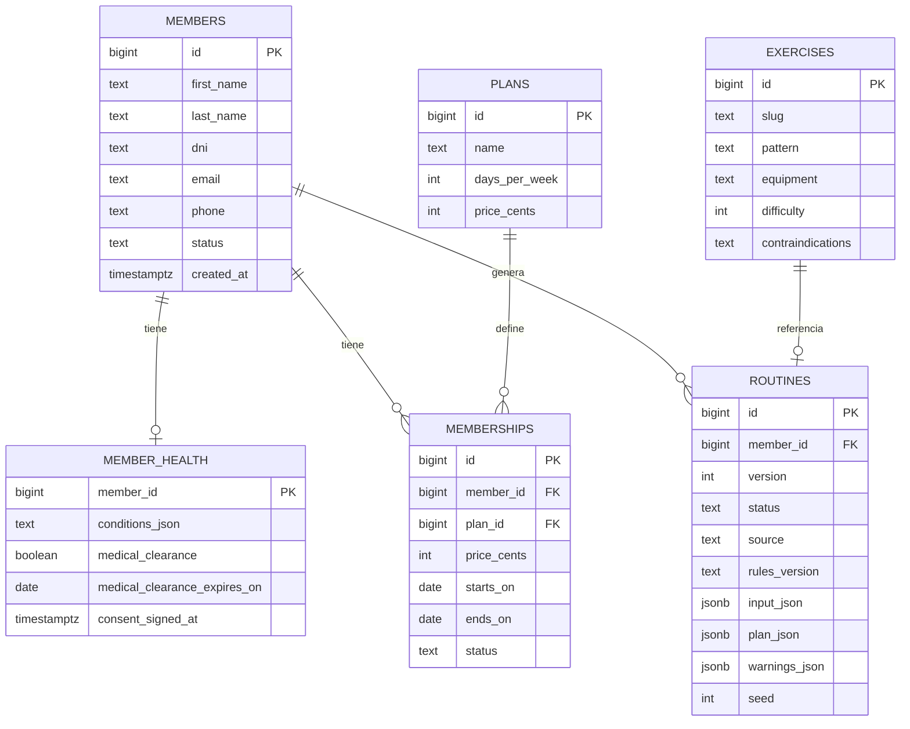

Puntos importantes del esquema actual:

- `routines` usa `UNIQUE(member_id, version)`. Toda edición o regeneración **crea una nueva versión**; el historial nunca se borra.
- `memberships.price_cents` guarda el **precio histórico** del plan al momento de la cuota.
- `member_health` guarda datos sensibles en `conditions_json`: dolor de pecho, mareos, enfermedad cardíaca, cirugía reciente o embarazo bloquean la generación automática y piden evaluación médica.

### 2.3 Autenticación actual

No hay tabla de usuarios. La autenticación es un HMAC firmado sobre una contraseña única definida en `.env` (`OWNER_PASSWORD` o `OWNER_PASSWORD_HASH`):

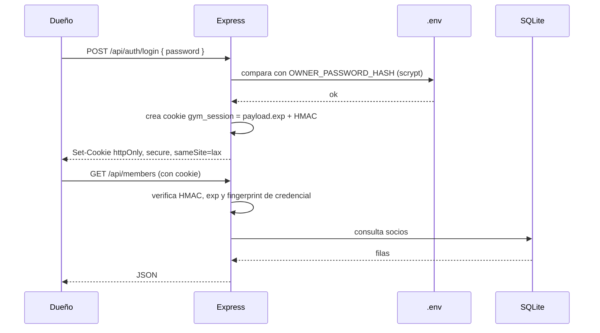

Detalles técnicos:

- Cookie `gym_session`, validez 12 horas.
- Firma HMAC-SHA256 con `SESSION_SECRET`, comparación con `timingSafeEqual`.
- `credentialFingerprint()` incluye sha256 de la credencial + secreto: cambiar la contraseña invalida todas las sesiones.
- `express-rate-limit`: 20 intentos / 15 min en `/login`.
- CSRF: middleware `requireSameOrigin` rechaza `Sec-Fetch-Site: cross-site` y orígenes no incluidos en `allowedOrigins`.
- `helmet` con CSP estricto, `trust proxy = 1`.

**Limitación central:** `requireAuth` solo responde « autenticado sí/no ». No hay `userId`, ni `role`, ni autorización por recurso. Darle acceso a un socio implicaría darle el panel completo.

### 2.4 Capacidades ya resueltas (se conservan)

- Panel con socios activos, cuotas por vencer, altas del mes, distribución por plan, últimos socios y rutinas recientes.
- ABM de socios con búsqueda por nombre/DNI/teléfono y archivado sin borrar historial.
- Salud: condiciones, lesiones, medicamentos, apto médico, consentimiento y notas.
- Planes de 3/4/5 días con precio editable; cada cuota guarda el precio histórico.
- Generador determinístico de rutinas por objetivo, nivel, días, duración, equipamiento, deporte, edad y condiciones.
- Edición manual y regeneración con nueva versión.
- PDF multi-página generado en servidor.

---

## 3. Estado actual: `form-refaccionado`

### 3.1 Stack y estructura

```
form-refaccionado/
└── src/
    ├── config/        env.js (PORT, HOST, ADMIN_SECRET, EVENT_DATE_TIME, BACKUP_INTERVAL_MS, DB_PATH)
    │                  constants.js (REGISTRATION_CUTOFF_MS = 1h, CANCELLATION_CUTOFF_MS = 2h)
    ├── controllers/   auth, admin, inscription
    ├── db/            index.js (sqlite3 callbacks) + repository.js
    ├── lib/crypto.js  HMAC("administradora") con ADMIN_SECRET
    ├── middleware/    auth.middleware.js, validate.middleware.js
    ├── public/        HTML/CSS/JS vanilla (formulario, login admin, panel admin)
    ├── routes/        public.routes.js, admin.routes.js
    ├── services/      inscription, admin, backup
    ├── utils/         cookies, dates, validator
    ├── app.js         Express + static + routers
    └── server.js      init DB + listen + setInterval(backup)
```

### 3.2 Modelo de datos y reglas actuales

```sql
CREATE TABLE ingresantes (
  id INTEGER PRIMARY KEY AUTOINCREMENT,
  nombre TEXT NOT NULL,
  apellido TEXT NOT NULL,
  email TEXT NOT NULL UNIQUE,
  telefono TEXT NOT NULL,
  creado_en TEXT NOT NULL DEFAULT CURRENT_TIMESTAMP
);
```

Reglas de negocio existentes (se mantendrán en el nuevo módulo):

- `validarNombre` / `validarApellido`: mínimo 3 caracteres.
- `validarEmail`: regex `/^[^\s@]+@[^\s@]+\.[^\s@]+$/`.
- `validarTelefono`: regex `/^[\d\s+-]{8,20}$/`.
- Inscripción abierta hasta **1 hora antes** del evento (`EVENT_DATE_TIME`).
- Cancelación permitida hasta **2 horas antes** del evento, por email.
- Backups: copia del archivo SQLite al iniciar y cada `BACKUP_INTERVAL_MS` (por defecto 30 min).

### 3.3 Autenticación actual

El panel admin usa una cookie `admin_auth` cuyo valor es `HMAC-SHA256("administradora", ADMIN_SECRET)` — un **token estático sin expiración de sesión ni identidad de usuario**. El login compara `req.body.secret === config.adminSecret`. No hay usuarios ni roles.

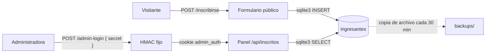

**Riesgos detectados:** token admin inmutable y reutilizable, un solo evento por variable de entorno, backup copiando un SQLite abierto, sin tests automatizados y sin separación entre identidad y autorización.

---

## 4. Arquitectura actual (visual)

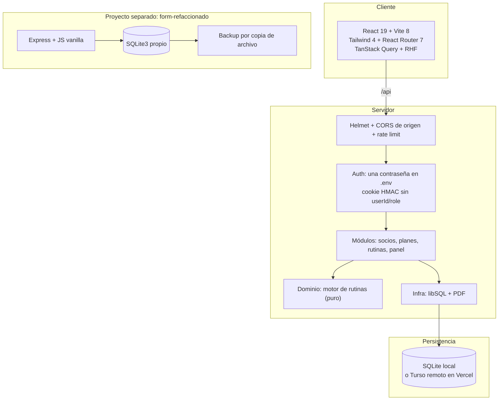

**Despliegue actual:** Vercel ejecuta la app como función serverless (`server.js` reexporta el bundle `dist/vercel/`). El filesystem es efímero, por eso la base remota es Turso/libSQL. Docker está disponible como alternativa autosustentada (`node:24-alpine`, healthcheck a `/api/health`).

---

## 5. Brechas frente a los nuevos requerimientos

| Requerimiento | Estado actual | Cambio necesario |
| --- | --- | --- |
| 100 socios con cuenta | No existe identidad de socio | Tabla `users`, alta de cuentas, invitaciones |
| 1 administradora (Belen) | Contraseña única compartida | Rol `admin` + rol `member` + policy layer |
| Autorización por recurso | `requireAuth` booleano | `requireRole`, `requireSelfOrAdmin`, RLS/sesiones |
| Socios ven solo lo suyo | Panel completo para cualquiera | Filtrado por `user.member_id` en repositorio y policy |
| Rutina sin PDF | PDF es el entregable | Vista HTML de la rutina en el portal del socio |
| Formularios de eventos | Proyecto separado, un evento por env | Módulo `events` en la app principal, varios eventos |
| Socios logueados responden | Formulario público anónimo | Inscripción vinculada a `member_id` + snapshot de datos |
| PostgreSQL | SQLite / Turso | Migración a Postgres + Drizzle |
| NGINX | No aplica en Vercel | Reverse proxy en VPS propio |
| Backups fiables | Copia de archivo SQLite | `pg_dump` cifrado en storage externo + restore drill |

---

## 6. Arquitectura objetivo

### 6.1 Vista de capas

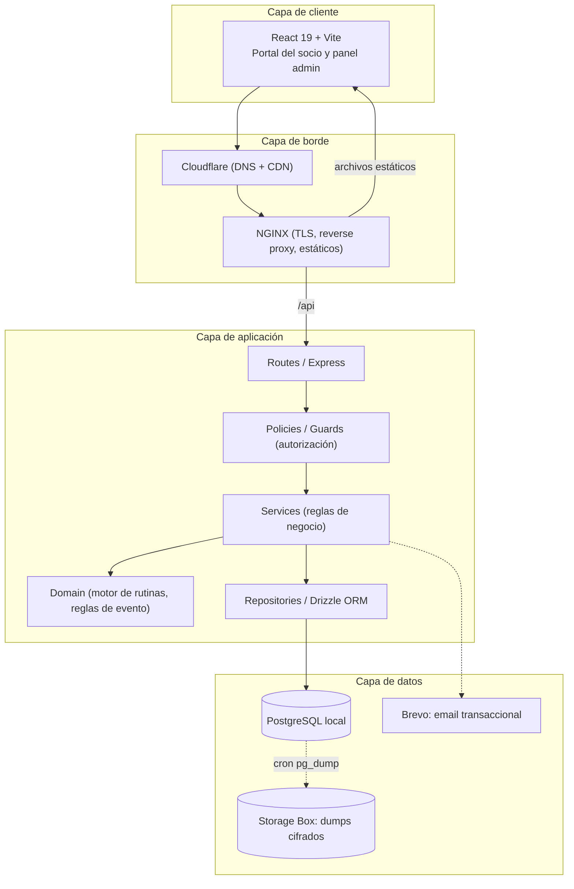

### 6.2 Vista de despliegue

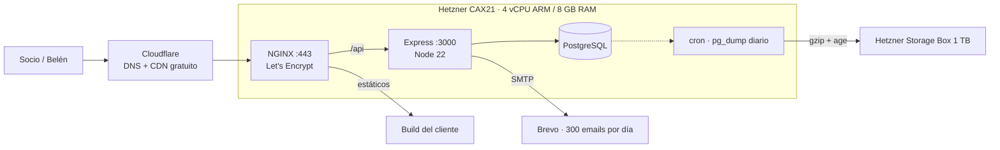

**Racional:** con 100 cuentas y concurrencia baja, un VPS de 8 GB sobra. NGINX hace terminación TLS, sirve el build del cliente y redirige `/api`. Cloudflare se pone delante solo para cachear estáticos y mitigar la latencia desde Argentina (~200 ms al server de Europa). Se elimina Vercel y Supabase.

### 6.3 Modelo de datos objetivo

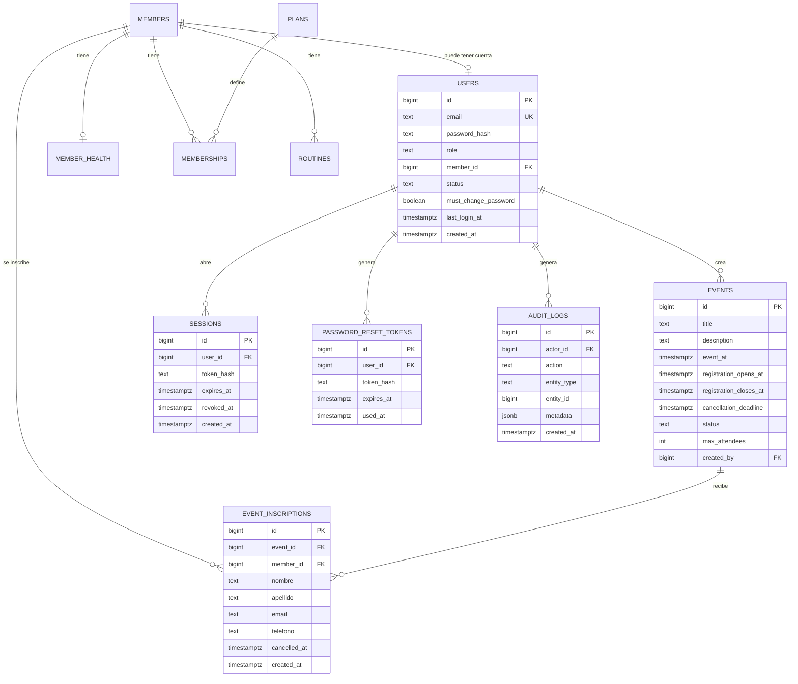

**Decisiones de diseño del modelo:**

- `users.member_id` es nullable: el usuario admin no tiene socio asociado; un socio puede no tener cuenta todavía.
- `role` con `CHECK (role IN ('admin','member'))`, nunca se toma del cliente.
- `event_inscriptions` guarda `nombre`, `apellido`, `email` y `telefono` como **snapshot** al inscribirse, aunque el socio ya esté logueado. Así el historial no cambia si Belen edita el socio después. Es el mismo criterio que `memberships.price_cents` en el MVP.
- `UNIQUE(event_id, member_id)` da idempotencia: un socio no puede inscribirse dos veces al mismo evento.
- `sessions` guarda solo el hash del token opaco: permite revocar sesiones y cerrar sesiones en tablets compartidas.

### 6.4 Flujo de autenticación objetivo

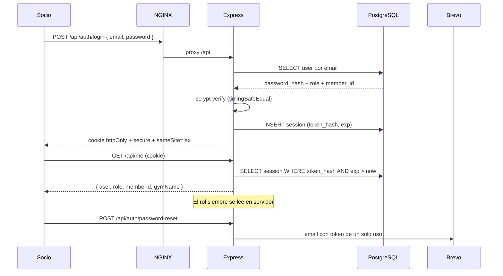

### 6.5 Flujo de inscripción a un evento

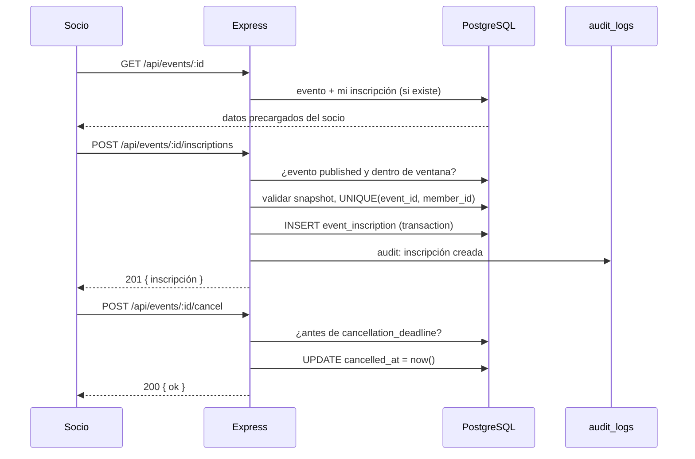

### 6.6 Ciclo de vida del evento (máquina de estados)

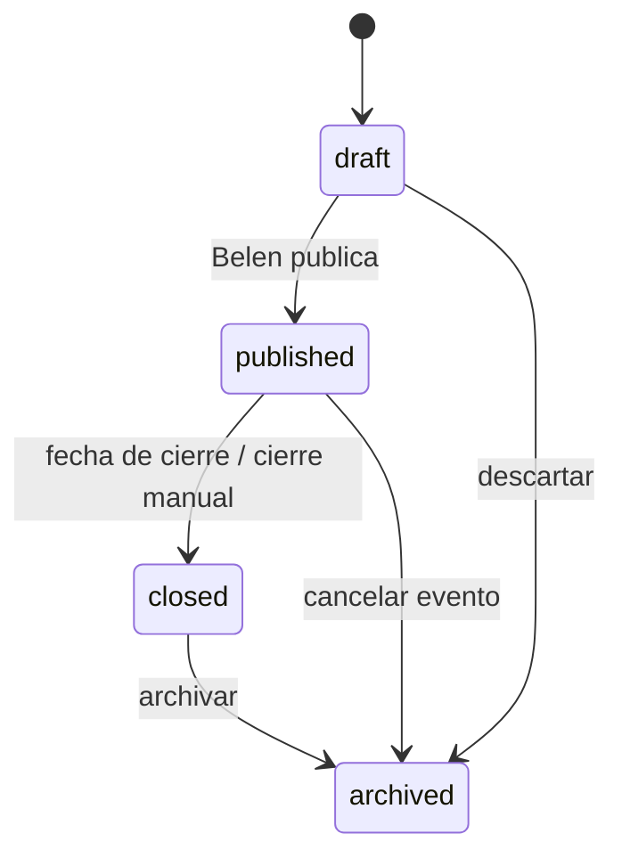

Las transiciones se validan en un único lugar (`events.service.ts`); un evento en `draft` no acepta inscripciones aunque la fecha ya haya pasado.

---

## 7. Cambios por módulo

### 7.1 `auth` → `users` + `sessions`

| Antes | Después |
| --- | --- |
| Contraseña única en `.env` | `users` con email + `password_hash` scrypt |
| Cookie HMAC sin identidad | Cookie con token opaco, hash en `sessions` |
| `requireAuth` booleano | `requireAuth` + `requireRole('admin')` + `requireSelfOrAdmin('memberId')` |
| Sin reseteo | `password_reset_tokens` + Brevo |
| Sin auditoría | `audit_logs` en cada acción administrativa |
| Login por password | Login por email + password, lockout tras N fallos |

La implementación de hashing ya existe (`src/server/modules/auth/password.ts`, scrypt N=16384/r=8/p=1) y se reutiliza sin cambios. El token de sesión cambia de HMAC stateless a valor aleatorio guardado hasheado en DB.

### 7.2 `members` → portal del socio

Endpoints nuevos, todos con `requireSelfOrAdmin`:

- `GET /api/me/routines` — lista de versiones del socio autenticado.
- `GET /api/me/routines/:version` — plan completo para renderizar en HTML.
- `GET /api/me/profile` — datos personales, salud y cuota vigente.
- Los endpoints de administración (`/api/members`, `/api/members/:id/routines`) quedan **detrás de `requireRole('admin')`**.

La vista `RoutinePlanView.tsx` ya existe y se reutiliza: el socio ve lo mismo que ve la dueña, pero sin acceso al wizard ni a datos de otros socios.

### 7.3 Módulo nuevo `events`

Estructura espejo de los módulos actuales:

```
src/server/modules/events/
├── routes.ts        ABM admin + inscripción/cancelación del socio
├── service.ts       máquina de estados, ventanas de fecha, reglas heredadas
├── repository.ts    Drizzle: events + event_inscriptions
└── schema.ts        Zod: eventInputSchema, inscriptionInputSchema
```

Reglas heredadas de `form-refaccionado` (se conservan textuales en mensajes al usuario):

- nombre y apellido ≥ 3 caracteres;
- email con regex estándar;
- teléfono `^[\d\s+-]{8,20}$`;
- cierre de inscripción 1 hora antes del evento;
- cancelación hasta 2 horas antes del evento.

Cambios respecto al proyecto viejo:

- `EVENT_DATE_TIME` (una variable global) → campos por evento.
- Formulario anónimo → socio autenticado con datos precargados.
- Panel con clave fija → panel con rol `admin`.
- Un solo evento → múltiples eventos con estado.

### 7.4 Capa de datos

`libsql`/`sqlite3` se reemplaza por **Drizzle ORM + `pg`**. Impacto concreto en el código:

- Las funciones `queryAll`, `queryOne`, `execute` y `transaction` de `infra/db/index.ts` pasan de síncronas a **async**.
- Los repositorios y servicios se vuelven `async`; los handlers de Express usan `asyncHandler` para propagar errores.
- `datetime('now')` → `now()`; `AUTOINCREMENT` → `GENERATED BY DEFAULT AS IDENTITY`; `INTEGER` booleanos → `boolean`; columnas `*_json TEXT` → `jsonb`.
- Las migraciones pasan de `migrations/*.sql` embebidas a `drizzle-kit generate` + `drizzle-kit migrate`.

### 7.5 Capa de borde y despliegue

- Se elimina `vercel.json` y el entrypoint `src/vercel.ts`; el servidor escucha normalmente en `127.0.0.1:3000`.
- NGINX sirve `public/` y hace `proxy_pass /api` con headers `X-Forwarded-*`.
- `app.set('trust proxy', 1)` se ajusta al chain real (Cloudflare + NGINX).
- HTTPS con Certbot; renovación automática vía cron.
- `express.static` sigue como fallback en desarrollo; en producción lo sirve NGINX.

---

## 8. Tecnologías y dependencias

### 8.1 Dependencias actuales de `gimnasio-mvp` y su propósito

| Dependencia | Uso actual |
| --- | --- |
| `express` 5 | Router HTTP y middlewares de la API |
| `zod` 4 | Validación de body, query y variables de entorno; esquemas compartidos |
| `libsql` | Driver SQLite local y cliente remoto de Turso |
| `dotenv` | Carga de `.env` |
| `cookie` | Parseo de la cookie de sesión |
| `helmet` | Headers de seguridad y CSP |
| `express-rate-limit` | Límite de intentos de login |
| `pino` + `pino-http` | Logs estructurados JSON |
| `@react-pdf/renderer` | PDF de la rutina en servidor, sin Chromium |
| `date-fns` | Cálculo de vencimientos y fechas de cuota |
| `react` / `react-dom` 19 | UI del panel |
| `react-router-dom` 7 | Rutas del cliente y rutas protegidas |
| `@tanstack/react-query` 5 | Caché y refetch de datos de la API |
| `react-hook-form` + `@hookform/resolvers` | Formularios validados con Zod |
| `tailwindcss` 4 + `@tailwindcss/vite` | Estilos utilitarios |
| `lucide-react` | Iconos |
| `sonner` | Notificaciones toast |
| `clsx` + `tailwind-merge` | Composición condicional de clases CSS |
| `@vercel/analytics` | Analytics en el deploy de Vercel |

**Desarrollo:** `typescript`, `tsx`, `tsup`, `vite`, `@vitejs/plugin-react`, `vitest`, `supertest`, `concurrently`, `pino-pretty` y los `@types/*` correspondientes.

### 8.2 Dependencias actuales de `form-refaccionado`

| Dependencia | Uso actual |
| --- | --- |
| `express` 5 | Servidor y rutas públicas/admin |
| `sqlite3` 6 | Base local con API de callbacks |
| `dotenv` 17 | Configuración por `.env` |
| `nodemon` (dev) | Recarga automática |

HTML, CSS y JS vanilla, sin framework de cliente ni tests.

### 8.3 Dependencias objetivo (producto final)

| Dependencia | Estado | Propósito en el producto final |
| --- | --- | --- |
| `express` 5 | Se mantiene | API única; se unifican los dos proyectos |
| `zod` 4 | Se mantiene | Validación de entrada y contrato compartido cliente/servidor |
| `pg` | **Nueva** | Driver de PostgreSQL |
| `drizzle-orm` | **Nueva** | Query builder tipado y repositorios |
| `drizzle-kit` (dev) | **Nueva** | Generación y aplicación de migraciones |
| `scrypt` (`node:crypto`) | Se mantiene | Hash de contraseñas (ya implementado) |
| `cookie` | Se mantiene | Parseo de cookies |
| `helmet` | Se mantiene | CSP y headers de seguridad |
| `express-rate-limit` | Se mantiene | Rate limit de login y de inscripción |
| `pino` + `pino-http` | Se mantienen | Logs estructurados (sin datos de salud) |
| `@react-pdf/renderer` | Se mantiene | Exportación opcional; la vista principal es HTML |
| `date-fns` | Se mantiene | Ventanas de inscripción y vencimientos |
| `react` / `react-dom` 19 | Se mantienen | Portal del socio + panel admin |
| `react-router-dom` 7 | Se mantienen | Rutas por rol |
| `@tanstack/react-query` 5 | Se mantienen | Caché con `staleTime` ya configurado |
| `react-hook-form` + resolvers | Se mantienen | Formularios de inscripción y alta de usuarios |
| `tailwindcss` 4 | Se mantiene | Estilos |
| `lucide-react` / `sonner` | Se mantienen | Iconos y toasts |
| `clsx` / `tailwind-merge` | Se mantienen | Utilidades de clases |
| `Brevo` (API HTTP) | **Nuevo** | Email de reseteo e invitaciones (300/día gratis) |
| `age` / `gpg` (binario) | **Nuevo** | Cifrado de los dumps antes de subirlos |
| `NGINX` + `Certbot` (sistema) | **Nuevos** | Reverse proxy, TLS y estáticos |
| `libsql` | **Se elimina** | Reemplazado por `pg` + Drizzle |
| `sqlite3` | **Se elimina** | Reemplazado por PostgreSQL |
| `@vercel/analytics` | **Se elimina** | No hay deploy en Vercel |

### 8.4 Justificación de la infraestructura

| Componente | Por qué |
| --- | --- |
| Hetzner CAX21 | 4 vCPU ARM / 8 GB / 80 GB por ~€10,49/mes; sobra para Node + Postgres + NGINX |
| Hetzner Storage Box | 1 TB por ~€3,20/mes para dumps cifrados fuera del servidor |
| Cloudflare (plan gratis) | DNS, CDN para estáticos y reduce latencia desde Argentina |
| Brevo (plan gratis) | 300 emails/día, suficiente para 100 socios |
| Let's Encrypt | TLS gratis, renovable con Certbot |
| PostgreSQL | Mejor herramienta de backups, `jsonb`, constraints y un solo sistema para ambos proyectos |

**Nota sobre PostgreSQL:** la razón no es throughput de escritura — 100 socios leyendo rutinas no saturan SQLite — sino ecosistema, backups gestionados por nosotros y unificar las dos bases en una sola.

---

## 9. Patrones de diseño aplicados

| Patrón | Dónde | Para qué |
| --- | --- | --- |
| Arquitectura en capas / hexagonal ligera | `domain` → `infra` → `modules` | El motor de rutinas sigue siendo puro y testeable sin DB |
| Repository | `*/repository.ts` | Aísla SQL/Drizzle del resto; facilita el cambio SQLite → Postgres |
| Service | `*/service.ts` | Reglas de negocio fuera de los handlers |
| Policy / Guard | `modules/auth/policies.ts` (nuevo) | Autorización centralizada, no `if` sueltos |
| State machine | `events.service.ts` | Transiciones válidas `draft → published → closed → archived` |
| Unit of Work | `db.transaction()` | Inscripción + auditoría en la misma transacción |
| Anti-corruption layer | Script ETL | Traduce los SQLite viejos al modelo nuevo sin contaminarlo |
| Schema-driven validation | `shared/schemas.ts` + Zod | Un solo contrato entre cliente y servidor |
| Idempotency key | `UNIQUE(event_id, member_id)` | Evita inscripciones duplicadas por doble click o reintento |
| Versionado inmutable | `UNIQUE(member_id, version)` | El historial de rutinas nunca se destruye |
| Cache stale-while-revalidate | TanStack Query + Cloudflare | Reduce llamadas a la API con 100 usuarios |

---

## 10. Plan de migración de datos

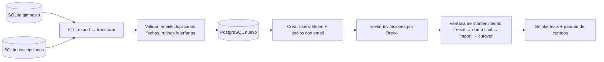

Pasos:

1. **Inventario y limpieza.** Detectar socios sin email (no se pueden invitar), emails duplicados y rutinas referidas a socios inexistentes.
2. **Esquema destino.** `drizzle-kit generate` sobre el modelo de la sección 6.3, con roles y grants limitados.
3. **ETL.** Script SQLite → JSON → Drizzle. Mapeo de tipos: `datetime('now')` → `now()`, `AUTOINCREMENT` → `identity`, `*_json TEXT` → `jsonb`, booleanos `0/1` → `boolean`.
4. **Usuarios.** Belen con `role='admin'` y `must_change_password=true`. Socios con email, `role='member'` y `member_id`. Invitaciones con token de reseteo de un solo uso.
5. **Cutover.** Ventana breve: congelar escrituras, dump final, import, cambiar variables de entorno, reiniciar, smoke tests.
6. **Retención.** Mantener ambos SQLite 30 días y validar paridad de conteos y checksums de `plan_json`.
7. **Rollback.** Si falla el smoke test, se restauran los env vars anteriores y se vuelve al SQLite.

---

## 11. Seguridad

- **Transporte:** HTTPS terminado en NGINX con Let's Encrypt; Cloudflare delante.
- **Cookies:** `httpOnly`, `secure`, `sameSite=lax`, `path=/`, 12 h de validez.
- **CSRF:** header `Origin` + `Sec-Fetch-Site`, igual que en el MVP.
- **Passwords:** scrypt N=16384/r=8/p=1 con salt aleatorio, comparación `timingSafeEqual`.
- **Sesiones:** tokens opacos hasheados en DB, revocables, con limpieza de expirados.
- **Lockout:** tras N intentos fallidos, bloqueo temporal + rate limit.
- **Autorización:** el rol siempre se obtiene en servidor desde `users`; nunca se confía en un claim del cliente.
- **DB:** la app conecta con un rol con grants limitados, **nunca** con `postgres` superuser. Sin RLS al no usar Supabase, la defensa es el policy layer + permisos de DB.
- **Datos sensibles:** las condiciones de salud no se loguean ni se incluyen en respuestas de auditoría.
- **Backups:** cifrados con `age`/`gpg` antes de salir del servidor.
- **Dispositivos compartidos:** logout explícito y expiración corta; deshabilitar «recordarme» en tablets del gimnasio.

---

## 12. Backups y operación

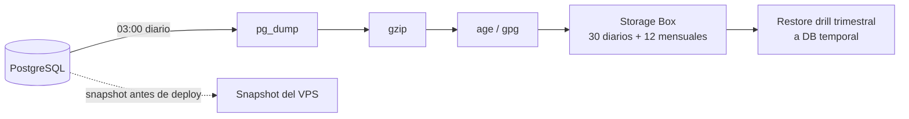

- `pg_dump` diario, gzip, cifrado y subida a Storage Box con retención de 30 diarios y 12 mensuales.
- **Restore drill trimestral**: restaurar un dump en una base temporal y verificar conteos. Es lo que convierte «hago copias» en «garantizo backups».
- Snapshot del VPS antes de cada deploy.
- Runbook documentado con los pasos de restauración y rotación de secretos.
- Monitoreo: `/api/health`, logs de NGINX y de la app, alerta si el backup falla.

---

## 13. Alternativas evaluadas

| Opción | One-shot | Mensual | Infra real | Margen mensual | Conclusión |
| --- | --- | --- | --- | --- | --- |
| A — Vercel + Supabase (Auth administrado) | $3.500.000 | $180.000 | ~$97.000 | ~$59.000 | Menos operación, pero la clienta paga más |
| **B — VPS Hetzner + NGINX + Auth propia** | **$4.100.000** | **$105.000** | **~$34.000** | **~$63.000** | **Recomendada: cumple el precio objetivo y deja margen** |
| C — Igual que B, por etapas | $2.400.000 + $1.700.000 | $105.000 desde Fase 1 | ~$34.000 | ~$63.000 | Útil si la clienta quiere pagar en etapas |
| Oracle Always Free | — | — | ~$8.000 | ~$97.000 | Descartado: el tier se recortó en 2026, sin SLA |
| Contabo | — | — | ~$27.000 | ~$78.000 | Precio promocional y soporte irregular |
| OVH | — | — | ~$52.000 | ~$53.000 | Facturación local en AR, pero el doble de caro |

---

## 14. Fuera de alcance

- Cobros, facturación y validación de comprobantes.
- Envío de recibos por WhatsApp.
- Reservas de turnos, asistencia o control de acceso.
- Preguntas personalizadas por evento (los formularios son de inscripción con los datos estándar).
- Múltiples gimnasios o sucursales.
- Relevamiento de socios sin email (responsabilidad de la clienta).

Cualquier ítem de esta lista se cotiza por separado como cambio de alcance.

---

## 15. Apéndice: variables de entorno objetivo

| Variable | Obligatoria | Descripción |
| --- | --- | --- |
| `NODE_ENV` | Sí | `production` en el VPS |
| `PORT` | No | `3000` por defecto, detrás de NGINX |
| `DATABASE_URL` | Sí | `postgresql://...` con el rol limitado de la app |
| `SESSION_SECRET` | Sí | Secreto para hashing de tokens de sesión (≥ 32 chars) |
| `APP_URL` | Sí | Origen público, usado por CSRF y emails |
| `APP_TZ` | No | `America/Argentina/Buenos_Aires` por defecto |
| `GYM_NAME` / `GYM_PHONE` / `GYM_ADDRESS` | No | Datos del gimnasio en UI y emails |
| `SMTP_HOST` / `SMTP_USER` / `SMTP_PASS` | Sí | Credenciales de Brevo |
| `BACKUP_DIR` | No | Ruta local temporal antes de subir a Storage Box |
| `S3_ENDPOINT` / `S3_BUCKET` / `S3_KEY` | Sí | Storage Box compatible con S3 para los dumps |
| `BACKUP_ENCRYPTION_KEY` | Sí | Clave pública `age` para cifrar los dumps |
| `LOG_LEVEL` | No | `info` por defecto |

Variables que **desaparecen**: `OWNER_PASSWORD`, `OWNER_PASSWORD_HASH`, `TURSO_DATABASE_URL`, `TURSO_AUTH_TOKEN`, `DATABASE_PATH`, `ADMIN_SECRET`, `EVENT_DATE_TIME`, `BACKUP_INTERVAL_MS`, `DB_PATH`.

---

**Fin del documento.**
