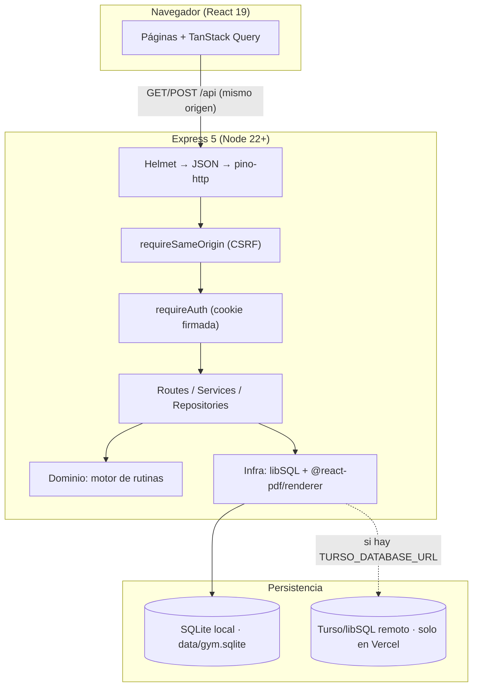
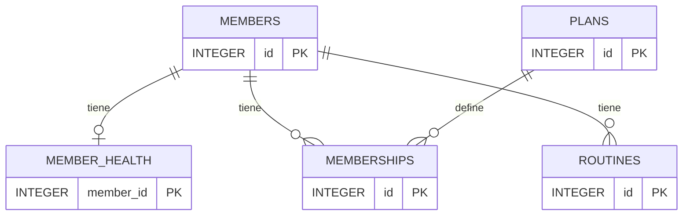
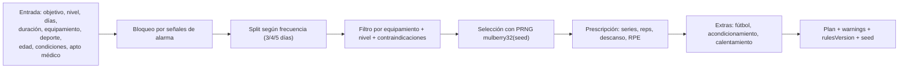

# Guía de funcionamiento, arquitectura y operación — `gimnasio-mvp`

Documentación de referencia para entender **qué hace cada parte del proyecto, por qué está ahí y cómo ejecutarlo/detenerlo en cada entorno**.

- **Fecha:** 25 de noviembre de 2026.
- **Código fuente:** `/home/herrtmalt/gimnasio-mvp`.
- **Documentos relacionados:**
  - `README.md`: resumen rápido, instalación y despliegue.
  - `docs/DOCUMENTACION_TECNICA.md`: diagnóstico y plan de migración a un producto con cuentas de socio, eventos, PostgreSQL y VPS (escenario *futuro*, no lo que hoy corre).
- **Convención:** las rutas de archivo se indican relativas a la raíz del repositorio. Los comandos se ejecutan desde esa raíz.

---

## Índice

1. [Qué es (y qué no es) este proyecto](#1-qué-es-y-qué-no-es-este-proyecto)
2. [Mapa de archivos y carpetas](#2-mapa-de-archivos-y-carpetas)
3. [Arquitectura y ciclo de vida de una petición](#3-arquitectura-y-ciclo-de-vida-de-una-petición)
4. [Modelo de datos](#4-modelo-de-datos)
5. [Funcionalidades explicadas](#5-funcionalidades-explicadas)
6. [API HTTP: endpoints disponibles](#6-api-http-endpoints-disponibles)
7. [Seguridad: cómo se protege el panel](#7-seguridad-cómo-se-protege-el-panel)
8. [Dependencias y razón de cada una](#8-dependencias-y-razón-de-cada-una)
9. [Variables de entorno](#9-variables-de-entorno)
10. [Scripts de npm](#10-scripts-de-npm)
11. [Protocolos de ejecución](#11-protocolos-de-ejecución)
12. [Cómo detenerlo en cada entorno](#12-cómo-detenerlo-en-cada-entorno)
13. [Mantenimiento, backups y problemas frecuentes](#13-mantenimiento-backups-y-problemas-frecuentes)

---

## 1. Qué es (y qué no es) este proyecto

Es un **panel interno de gestión para un gimnasio pequeño**, pensado para usarse en tablet o PC, con un **único usuario** (la dueña/dueño). La contraseña no está en una tabla de usuarios: se valida contra una variable de entorno (`OWNER_PASSWORD` o su hash `OWNER_PASSWORD_HASH`).

**Incluye**

- Login con contraseña y cookie de sesión firmada.
- Panel con indicadores operativos.
- Altas, ediciones, búsqueda y archivado de socios.
- Ficha de salud de cada socio (condiciones, lesiones, medicamentos, apto médico, consentimiento).
- Planes de 3/4/5 días con precio editable.
- Registro de cuotas con precio histórico.
- Generador determinístico de rutinas, con edición manual, regeneración e historial versionado.
- Descarga/impresión de cada rutina en PDF.
- Tres formas de ejecución: desarrollo local, contenedor Docker y función serverless en Vercel + base remota Turso.

**No incluye** (y por eso no hay código al respecto): facturación, cobros, WhatsApp, roles/empleados, reservas de turnos, asistencia ni portal para socios. Si querés ver cómo se planea agregar eso, leé `docs/DOCUMENTACION_TECNICA.md`.

**Decisión de diseño transversal:** el historial nunca se destruye. Archivar un socio no lo borra; editar/regenerar una rutina crea una nueva versión; cambiar el precio de un plan no altera las cuotas ya registradas.

---

## 2. Mapa de archivos y carpetas

```text
gimnasio-mvp/
├── package.json                  Dependencias, scripts y motor de Node requerido
├── package-lock.json             Versiones exactas (npm ci la usa en Docker/Vercel)
├── tsconfig.json                 Configuración de TypeScript (strict, noEmit)
├── vite.config.ts                Dev server + proxy /api + build del cliente
├── vitest.config.ts              Configuración de tests (entorno node)
├── tsup.config.ts                Bundle del servidor (dist/server y dist/vercel)
├── vercel.json                   Framework, build, entrypoint y rewrites en Vercel
├── server.js                     Entrypoint que Vercel detecta como app Express
├── index.html                    Plantilla HTML del cliente (Vite la transforma)
├── Dockerfile                    Build multi-stage para producción en contenedor
├── .dockerignore / .gitignore    Qué no se copia al build / qué no se versiona
├── .env.example                  Plantilla de variables de entorno
├── migrations/
│   └── 001_init.sql              Esquema SQLite inicial (6 tablas + índices; `schema_migrations` se crea en tiempo de ejecución)
├── scripts/
│   ├── migrate.ts                Aplica migraciones y cierra la DB
│   ├── seed.ts                   Migraciones + carga de planes y ejercicios
│   ├── hash-password.ts          Genera un hash scrypt para OWNER_PASSWORD_HASH
│   └── generate-migrations.mjs   Embebe los .sql en un archivo TS del bundle
├── src/
│   ├── shared/                   Contratos compartidos cliente/servidor
│   │   ├── types.ts              Enums, etiquetas y tipos de dominio
│   │   └── schemas.ts            Esquemas Zod de entrada y validación
│   ├── server/
│   │   ├── config/env.ts         Validación de .env con Zod al arrancar
│   │   ├── domain/routines/      Motor puro de rutinas + catálogo de ejercicios
│   │   │   ├── engine.ts         Reglas, splits, filtros, prescripción y advertencias
│   │   │   └── exercises.ts      Catálogo (59 ejercicios) + tipos de patrones
│   │   ├── infra/
│   │   │   ├── db/index.ts       Driver libSQL: local (SQLite) o remoto (Turso)
│   │   │   ├── db/migrate.ts     Control de migraciones aplicadas
│   │   │   ├── db/migrations.generated.ts  SQL embebido (autogenerado)
│   │   │   ├── db/seed.ts        Carga idempotente de planes y ejercicios
│   │   │   └── pdf/              Documento React PDF + render a Buffer
│   │   ├── modules/              Una carpeta por funcionalidad de negocio
│   │   │   ├── auth/             Login, cookie, contraseña y middlewares
│   │   │   ├── members/          Socios, salud, cuotas e historial
│   │   │   ├── plans/            Listado y actualización de precios
│   │   │   ├── routines/         Rutinas: preview, guardado, edición, PDF
│   │   │   └── dashboard/        Consultas agregadas del panel
│   │   ├── shared/               Utilidades server: fechas, errores, mapeo, validación
│   │   ├── app.ts                Armado de Express: middlewares, rutas, estáticos, errores
│   │   └── index.ts              Arranque normal (listen) + apagado graceful
│   ├── vercel.ts                 Arranque serverless (sin listen, exporta app)
│   └── client/
│       ├── main.tsx              Punto de entrada React (#root)
│       ├── App.tsx               Providers, rutas y protección de sesión
│       ├── index.css             Tailwind 4 + estilos globales y print
│       ├── components/           Layout, vistas de rutina y UI reutilizable
│       ├── lib/                  Cliente HTTP, contexto de auth y utilidades
│       └── pages/                Login, panel, socios, planes y rutinas
├── tests/                        Unitarios + API (Vitest y Supertest)
├── public/                       Salida del build del cliente (generado, ignorado por git)
├── dist/                         Salida del build del servidor (generado)
└── data/gym.sqlite*              Base local (generada, ignorada por git)
```

### Por qué esta separación

- **`src/shared`** evita que cliente y servidor tengan definiciones distintas de los mismos datos. Zod valida en el servidor y los tipos derivados se usan en React.
- **`domain`** es lógica pura: `generateRoutine()` no toca la base ni Express. Por eso se puede testear con una semilla fija y sin levantar el servidor.
- **`infra`** concentra las dependencias externas (base de datos y PDF). Si mañana se cambia SQLite por Postgres, el cambio queda acotado acá y en los repositorios.
- **`modules/<nombre>`** sigue el patrón *routes → service → repository*: la ruta valida y responde, el service aplica reglas de negocio, el repository habla con SQL.
- **`src/vercel.ts`** existe porque en serverless no se llama a `app.listen()`: la plataforma invoca la app exportada.

---

## 3. Arquitectura y ciclo de vida de una petición



**Flujo típico (por ejemplo, guardar una cuota):**

1. El usuario completa el formulario en `MemberDetailPage.tsx`; `react-hook-form` valida en el cliente y `useMutation` llama a `api()` (`src/client/lib/api.ts`).
2. `api()` hace `fetch('/api/members/:id/memberships', { credentials: 'same-origin' })`. En desarrollo, Vite redirige `/api` a `http://localhost:3000` (`vite.config.ts`).
3. Express aplica `helmet`, `express.json`, `pino-http`, `requireSameOrigin` y `requireAuth` (`src/server/app.ts`).
4. `membersRouter` valida el cuerpo con `membershipInputSchema` (Zod) y llama a `addMembership()`.
5. El service verifica que el socio y el plan existan y estén activos; el repository, dentro de una transacción, marca `expired` la cuota anterior, inserta la nueva con el `price_cents` **copiado del plan** y devuelve la ficha completa.
6. TanStack Query actualiza la caché y muestra un toast con `sonner`.

**Arranque del servidor (`src/server/index.ts`):**

```text
runMigrations() → seedDatabase() → createApp() → app.listen(PORT) → logs
```

Las migraciones y el seed son **idempotentes**: se pueden ejecutar en cada reinicio sin duplicar datos. `closeDb()` se llama al recibir `SIGINT`/`SIGTERM`, con un timeout de 5 s como salvaguarda.

**Arranque en Vercel (`src/vercel.ts`):** igual, pero sin `listen()`. El módulo se evalúa en cada *cold start*, por eso migraciones y seed son seguros de repetir.

---

## 4. Modelo de datos

Esquema definido en `migrations/001_init.sql` y embebido en `src/server/infra/db/migrations.generated.ts` para que el bundle lo lleve consigo.



| Tabla | Para qué sirve | Reglas importantes |
| --- | --- | --- |
| `members` | Datos personales, contacto, emergencia, notas y `status` | `status ∈ active/inactive/archived`. La búsqueda excluye archivados. |
| `member_health` | Información de salud del socio (1:1) | `conditions_json` guarda las condiciones declaradas; `consent_signed_at` se registra una vez y se conserva en ediciones posteriores. |
| `plans` | Planes de 3, 4 y 5 días por semana | `days_per_week` es único; `price_cents` se puede editar. |
| `memberships` | Historial de cuotas | Guarda `price_cents` **histórico**. Al insertar una nueva, las activas pasan a `expired` en la misma transacción. |
| `exercises` | Catálogo de 59 ejercicios | `slug` único; `equipment`, `contraindications` y `sport_tags` se guardan como JSON en texto. |
| `routines` | Cada versión de cada rutina | `UNIQUE(member_id, version)`; guarda `input_json`, `plan_json`, `warnings_json`, `seed`, `rules_version` y `source`. |
| `schema_migrations` | Control interno de migraciones aplicadas | `version` es la clave primaria; `runMigrations()` solo ejecuta las que faltan. |

**Decisiones que conviene recordar**

- **Precios históricos:** si hoy el plan de 3 días cuesta $30.000 y mañana lo suben, la cuota ya cargada sigue mostrando $30.000.
- **Versionado inmutable:** editar o regenerar nunca `UPDATE` una rutina; siempre `INSERT` con `version = MAX(version) + 1`.
- **Archivado lógico:** `archiveMember()` solo cambia el `status`; cuotas y rutinas siguen consultables desde la ficha.
- **PRAGMAs de SQLite local:** `journal_mode = WAL`, `foreign_keys = ON`, `busy_timeout = 5000`, `synchronous = NORMAL`. Los archivos `-wal` y `-shm` son parte de la base (ver [backups](#13-mantenimiento-backups-y-problemas-frecuentes)).
- **Zonas horarias:** `today()` usa `Intl` con `APP_TZ` → `TZ` → `America/Argentina/Buenos_Aires`. Vercel define `TZ=:UTC`, por eso el `:` se limpia y `APP_TZ` tiene prioridad (`src/server/shared/dates.ts`).

---

## 5. Funcionalidades explicadas

### 5.1 Login y sesión

- `POST /api/auth/login` valida la contraseña con `verifyOwnerPassword()`:
  - Si existe `OWNER_PASSWORD_HASH`, usa `scrypt` con salt aleatorio y comparación `timingSafeEqual`.
  - Si no, compara con `OWNER_PASSWORD` hasheando ambos lados con SHA-256 (`safeCompare`) para no filtrar longitud por timing.
- Si está bien, responde con la cookie `gym_session`:
  - `payload = base64url({ exp, v })` donde `exp` es ahora + 12 h y `v` es una huella SHA-256 de la credencial + `SESSION_SECRET`.
  - Firma HMAC-SHA256 del payload con `SESSION_SECRET`.
  - Atributos: `httpOnly`, `sameSite=lax`, `path=/`, `maxAge=12 h`, `secure` automático en producción (configurable con `COOKIE_SECURE`).
- Cambiar la contraseña o el secreto cambia la huella `v` y **invalida todas las sesiones existentes**.
- `GET /api/auth/me` devuelve `{ authenticated, gymName, gymPhone }`; el cliente lo usa al cargar para decidir si muestra el panel o el login.
- `POST /api/auth/logout` limpia la cookie.
- Rate limit: 20 intentos cada 15 minutos por IP (`express-rate-limit`).
- En el cliente, `AuthProvider` (`src/client/lib/auth.tsx`) mantiene `loading | authenticated | unauthenticated`. Si cualquier API responde 401, dispara el evento `auth:unauthorized`, limpia la caché de TanStack Query y redirige a `/login`.

### 5.2 Panel (`/`)

`GET /api/dashboard` calcula, con la fecha de hoy en la zona horaria configurada:

- **Socios activos:** `status = active` **y** membresía `active` con `ends_on >= hoy`.
- **Vencen en 7 días:** mismas condiciones con `ends_on` entre hoy y hoy + 7.
- **Nuevos este mes:** altas desde el primer día del mes, excluyendo archivados.
- **Sin cuota activa:** socios `active` sin membresía vigente.
- **Distribución por plan**, **últimos 5 socios**, **últimas 5 rutinas** y lista de cuotas por vencer (max. 10).

El estado del socio **no cambia automáticamente** al vencer una cuota: el panel lo muestra como "sin cuota vigente" y avisa con un alert. El criterio es por fecha de fin, no por un job nocturno.

### 5.3 Socios (`/socios`, `/socios/nuevo`, `/socios/:id`, `/socios/:id/editar`)

- La búsqueda es por **nombre, apellido, DNI o teléfono** (`LIKE % término %`) y el servidor devuelve como máximo 300 filas ordenadas por apellido.
- El cliente aplica un **debounce de 300 ms** (`useDebounced`) y mantiene los datos anteriores durante la búsqueda (`keepPreviousData`).
- Filtros: todos / activos / inactivos / sin cuota. El último se calcula en el cliente comparando `membershipEndsOn` con la fecha actual.
- La ficha muestra: membresía actual y su estado, historial de cuotas, rutinas con acceso a ver/PDF, datos de contacto, contacto de emergencia, notas internas y salud.
- **Archivar** (`POST /api/members/:id/archive`) oculta al socio de la lista principal pero conserva todo su historial.

### 5.4 Salud

En el alta/edición (`MemberFormPage.tsx`) se registran:

- Condiciones declaradas (12 opciones: dolor de rodilla/hombro/lumbar, hipertensión, asma, diabetes, embarazo, enfermedad cardíaca, cirugía reciente, mareos, dolor de pecho, otra).
- Lesiones, medicamentos, notas de salud.
- Apto médico (booleano) y su fecha de vencimiento.
- Consentimiento informado: al marcarlo se guarda `consent_signed_at`; al desmarcarlo se limpia.

Estos datos condicionan directamente el generador de rutinas (ver 5.6) y se muestran en la ficha con badges de estado.

### 5.5 Planes y cuotas

- `GET /api/plans` lista los tres planes creados por el seed. `PATCH /api/plans/:id` cambia solo `price_cents` (entero, 0 a 100.000.000).
- `POST /api/members/:id/memberships` recibe `{ planId, startsOn, endsOn, notes }`; Zod exige formato `AAAA-MM-DD` y que `endsOn >= startsOn`.
- Dentro de una transacción: se marcan como `expired` las cuotas activas del socio y se inserta la nueva copiando el precio del plan.
- La UI de registro sugiere inicio = hoy y fin = hoy + 1 mes, y muestra el precio y los días de vigencia antes de confirmar.

### 5.6 Generador de rutinas (el corazón del dominio)

Implementado en `src/server/domain/routines/engine.ts`, con 59 ejercicios en `exercises.ts`. Es **determinístico**: misma entrada + misma semilla = mismo plan (hay un test que lo verifica).



Paso a paso:

1. **Bloqueo de seguridad.** Si hay `chest_pain`, `dizziness`, `heart_condition`, `recent_surgery` o `pregnancy`, se lanza `RoutineSafetyError` → HTTP 422 `ROUTINE_SAFETY`. No se genera nada.
2. **Semilla.** Si no se pasa `seed`, se elige una aleatoria; si se pasa, se usa `mulberry32(seed + índiceDelDía * 1000)` para barajar y elegir ejercicios de forma reproducible.
3. **Split.** 3 días = cuerpo completo ×3; 4 días = superior/inferior alternados; 5 días = empuje, tracción, piernas, superior, inferior.
4. **Filtros.** `isAvailable()` exige que todo el equipamiento del ejercicio esté disponible (siempre se cuenta `bodyweight`), que la dificultad sea ≤ nivel y que no tenga tags contraindicados por las condiciones declaradas (p. ej., dolor de rodilla bloquea `knee_flexion` e `impact`).
5. **Selección.** Se priorizan ejercicios con tags de fútbol o generales según el deporte, y con dificultad acorde al objetivo. Si no hay candidato para un patrón, se prueban patrones de reemplazo (`FALLBACK_PATTERNS`) y se registra una advertencia.
6. **Prescripción.** Fuerza = 4×3-6 con 150 s; hipertrofia = 4×6-10 con 120 s; grasa = 3×10-15 con 60 s; resistencia = 3×12-20 con 45 s; salud general = 3×8-12 con 90 s. Se ajusta por nivel, por ser accesorio y por temporada de fútbol (una serie menos en piernas si está `in_season`).
7. **Extras.** Calentamiento y vuelta a la calma según foco; para fútbol se suman 2 accesorios preventivos (nórdicos, aductores, Copenhagen, etc.); para objetivos de grasa/resistencia se agrega acondicionamiento en los primeros dos días.
8. **Advertencias.** Se generan avisos por: falta de apto médico, condiciones declaradas, solo peso corporal, 5 días con sesiones de 45 min, edad ≥ 65, hipertensión, temporada de fútbol, reemplazos y huecos sin ejercicio compatible. Siempre se incluye un `disclaimer` médico.
9. **Resultado.** `{ plan, warnings, rulesVersion: '1.0.0', seed }`.

**Ciclo de vida de una rutina**

| Acción | Endpoint | Qué pasa |
| --- | --- | --- |
| Previsualizar | `POST /api/members/:id/routines/preview` | Genera y devuelve el plan **sin guardar**. |
| Guardar | `POST /api/members/:id/routines` | Regenera con la semilla recibida, guarda `input`, `plan` y `warnings` como `source: 'auto'`, versión nueva. |
| Ver | `GET /api/routines/:id` | Devuelve la versión guardada. |
| Editar | `PATCH /api/routines/:id` | Crea una versión nueva con `source: 'manual'`, `seed: 0` y una advertencia extra: "Rutina editada manualmente…". La original queda intacta. |
| Regenerar | `POST /api/routines/:id/regenerate` | Crea una versión nueva con `seed + 1`, mismos datos de entrada, `source: 'auto'`. |

El asistente (`RoutineWizardPage.tsx`) tiene 3 pasos (objetivo/nivel/deporte/edad → frecuencia/duración/equipamiento → salud), precarga datos desde la ficha del socio y deshabilita "Generar" si hay señales de alarma o no hay equipamiento elegido.

### 5.7 Visualización y PDF

- `RoutinePlanView.tsx` es la misma vista usada en la previsualización y en la rutina guardada: resumen, tarjetas por día con calentamiento, bloques (principal / accesorios / cardio), vuelta a la calma, notas, progresión y aviso importante. Es responsive: tabla en pantallas grandes, tarjetas en el celular.
- `GET /api/routines/:id/pdf` genera el documento en el servidor con `@react-pdf/renderer` (`RoutineDocument.tsx`): A4 multipágina, encabezado con nombre del gimnasio, datos del socio, tablas de ejercicios, progresión, `disclaimer` y pie con "Página X de Y". El nombre del archivo se normaliza (sin acentos ni caracteres raros): `rutina-<apellido>-<nombre>-v<versión>.pdf`.

---

## 6. API HTTP: endpoints disponibles

Base: `/api`. Todas las respuestas de error tienen el formato:

```json
{ "error": { "code": "VALIDATION_ERROR", "message": "…", "details": {} } }
```

Códigos usados: `UNAUTHORIZED` (401), `CSRF` (403), `NOT_FOUND` (404), `VALIDATION_ERROR` (400), `CONFLICT` (409), `ROUTINE_SAFETY` (422), `RATE_LIMITED` (429), `INTERNAL_ERROR` (500).

| Método | Ruta | Auth | Descripción |
| --- | --- | --- | --- |
| GET | `/api/health` | No | Health check; responde `{ ok: true, app: 'gimnasio-mvp' }`. Lo usa el HEALTHCHECK de Docker. |
| POST | `/api/auth/login` | No | Valida contraseña, aplica rate limit y setea la cookie. |
| POST | `/api/auth/logout` | No* | Borra la cookie. |
| GET | `/api/auth/me` | Sí | Estado de sesión + nombre/teléfono del gimnasio. |
| GET | `/api/members?q=&status=` | Sí | Lista socios (excluye archivados; búsqueda por nombre/DNI/teléfono). |
| POST | `/api/members` | Sí | Alta de socio con datos de salud. |
| GET | `/api/members/:id` | Sí | Ficha completa: socio + cuotas + rutinas. |
| PATCH | `/api/members/:id` | Sí | Edición parcial de socio y/o salud. |
| POST | `/api/members/:id/archive` | Sí | Archiva (no borra). |
| POST | `/api/members/:id/memberships` | Sí | Registra cuota y finaliza la anterior. |
| POST | `/api/members/:memberId/routines/preview` | Sí | Genera rutina sin guardar. |
| POST | `/api/members/:memberId/routines` | Sí | Guarda rutina como versión nueva. |
| GET | `/api/routines/:id` | Sí | Devuelve una rutina guardada. |
| PATCH | `/api/routines/:id` | Sí | Guarda una nueva versión editada a mano. |
| POST | `/api/routines/:id/regenerate` | Sí | Guarda una nueva versión con otra semilla. |
| GET | `/api/routines/:id/pdf` | Sí | Devuelve el PDF (Content-Type `application/pdf`). |
| GET | `/api/exercises` | Sí | Catálogo activo de ejercicios. |
| GET | `/api/plans` | Sí | Planes disponibles. |
| PATCH | `/api/plans/:id` | Sí | Actualiza el precio del plan. |
| GET | `/api/dashboard` | Sí | Indicadores del panel. |

\* `logout` no exige sesión para poder limpiar una cookie vencida.

**Orden de los middlewares en `app.ts` (importante):** `helmet` → `express.json` → `pino-http` → `/api/health` → `requireSameOrigin` → `/api/auth/*` → `requireAuth` → resto de módulos → 404 de API → estáticos + fallback SPA → manejador de errores.

---

## 7. Seguridad: cómo se protege el panel

| Mecanismo | Dónde | Qué evita y por qué |
| --- | --- | --- |
| Cookie HMAC-SHA256 | `modules/auth/service.ts` | La sesión viaja firmada; modificar `exp` o la huella invalida la cookie. No se guarda estado en la base. |
| `timingSafeEqual` | `auth/service.ts`, `auth/password.ts` | Comparaciones en tiempo constante contra ataques de timing. |
| `scrypt` (N=16384, r=8, p=1) | `auth/password.ts` | Guardar la contraseña como hash en vez de texto plano; el script `hash-password` genera el valor para `.env`. |
| Huella de credencial | `credentialFingerprint()` | Cambiar contraseña o `SESSION_SECRET` cierra todas las sesiones sin necesidad de una tabla de revocación. |
| Rate limit 20/15 min | `auth/routes.ts` | Dificulta fuerza bruta en `/login`. |
| CSRF `requireSameOrigin` | `auth/middleware.ts` | Rechaza escrituras con `Sec-Fetch-Site: cross-site` u `Origin` fuera de `allowedOrigins`. Los GET/HEAD/OPTIONS pasan. |
| `helmet` + CSP | `app.ts` | Cabeceras de seguridad: solo recursos `'self'`, sin `objectSrc`, sin `frameAncestors`, estilos inline permitidos (Tailwind/Vite). |
| `trust proxy = 1` | `app.ts` | Express interpreta `X-Forwarded-For` correctamente detrás de Vercel/NGINX para el rate limit y cookies `secure`. |
| Zod en todas las entradas | `shared/schemas.ts`, `shared/validation.ts` | Rechaza datos mal formados antes de tocar la base; `parseId()` evita IDs inválidos. |
| Consultas parametrizadas | `infra/db/index.ts`, repositories | Prevención de inyección SQL. |
| Logs controlados | `app.ts`, `config/env.ts` | `pino` estructurado; en test (`LOG_LEVEL=silent`) y en producción sin `pino-pretty`. No se loguean condiciones de salud. |

**Limitación conocida:** hay un solo nivel de acceso. `requireAuth` responde solo "sí/no autenticado"; no hay `userId`, `role` ni autorización por recurso. Cualquier persona con la contraseña ve todo el panel. Esto es deliberado en el MVP; el diseño con roles está en `DOCUMENTACION_TECNICA.md`.

---

## 8. Dependencias y razón de cada una

### 8.1 Dependencias de producción (`dependencies`)

| Dependencia | Versión en `package.json` | Dónde se usa | Por qué está |
| --- | --- | --- | --- |
| `express` | ^5.3.0 | `src/server/app.ts`, todos los `routes.ts` | Servidor HTTP y enrutamiento de la API; también sirve los estáticos del build. |
| `zod` | ^4.6.7 | `config/env.ts`, `shared/schemas.ts`, `shared/validation.ts` | Un solo contrato de validación para variables de entorno, bodies y tipos compartidos con el cliente. |
| `libsql` | ^0.5.29 | `infra/db/index.ts` | Driver SQLite con API síncrona: abre `data/gym.sqlite` en local/Docker y habla con Turso por `libsql://` en Vercel, sin cambiar los repositorios. |
| `dotenv` | ^18.0.9 | `import 'dotenv/config'` en `config/env.ts` | Carga `.env` en desarrollo. En Docker/Vercel las variables llegan como environment real (y `.env` no se copia a la imagen), así que no depende del archivo. |
| `cookie` | ^2.0.2 | `modules/auth/service.ts` | Parseo robusto de la cabecera `Cookie` para leer `gym_session`. |
| `helmet` | ^8.3.0 | `app.ts` | Cabeceras de seguridad y CSP con una lista explícita de orígenes permitidos. |
| `express-rate-limit` | ^8.7.3 | `modules/auth/routes.ts` | Límite de 20 intentos de login por IP en 15 minutos. |
| `pino` + `pino-http` | ^10.4.0 / ^11.0.0 | `app.ts`, `server/index.ts` | Logs JSON estructurados con ID de request; en producción no agregan color para que los recoja Vercel/Docker. |
| `@react-pdf/renderer` | ^4.9.0 | `infra/pdf/RoutineDocument.tsx`, `render.tsx` | Genera el PDF de la rutina con componentes React en el servidor, sin Chromium ni navegador. |
| `date-fns` | ^4.4.0 | `server/shared/dates.ts` | Sumar días/meses y calcular inicio de mes para vencimientos y panel. |
| `react` + `react-dom` | ^19.3.1 | `src/client/**` | Interfaz del panel; `createRoot` en `main.tsx`. |
| `react-router-dom` | ^7.18.5 | `App.tsx`, `AppLayout.tsx`, páginas | Rutas del SPA, navegación, parámetros `:id` y redirección de rutas protegidas. |
| `@tanstack/react-query` | ^5.106.1 | `App.tsx`, páginas y `auth.tsx` | Caché de datos de la API, invalidación tras mutaciones, `staleTime` de 20 s y retry. Evita recargas innecesarias en tablets. |
| `react-hook-form` | ^7.91.0 | `LoginPage.tsx`, `MemberFormPage.tsx` | Formularios controlados, validación con mensajes en español y estados `isSubmitting`. |
| `@hookform/resolvers` | ^7.0.3 | **Declarada, hoy sin imports en `src/`** | Integración de RHF con validadores externos (Zod). Los formularios actuales usan reglas de `register()`; queda disponible para futuras migraciones. |
| `lucide-react` | ^1.70.0 | Componentes y páginas | Biblioteca de iconos SVG usada en navegación, botones y tarjetas. |
| `sonner` | ^2.0.8 | `App.tsx` + mutaciones | Notificaciones toast (guardado correcto/errores) sin implementar un sistema propio. |
| `clsx` + `tailwind-merge` | ^2.1.1 / ^3.7.0 | `client/lib/utils.ts` (`cn()`) | Componer clases condicionales y resolver conflictos de Tailwind (p. ej. `px-2` + `px-4`). |
| `@vercel/analytics` | ^2.0.1 | **Declarada, hoy sin imports en `src/`** | Analytics del deploy en Vercel; no está inyectado actualmente en el cliente. |

> **Nota de precisión:** el driver real es el paquete `libsql` **también para el archivo local** (no `node:sqlite`). `node:crypto`, `node:fs`, `node:path` y `node:events` son módulos nativos de Node y no figuran en `package.json`.

### 8.2 Dependencias de desarrollo (`devDependencies`)

| Dependencia | Versión en `package.json` | Para qué se usa |
| --- | --- | --- |
| `typescript` | ^7.0.2 | Chequeo estricto de tipos (`npm run typecheck`) con `noEmit`; no genera JS directamente. |
| `tsx` | ^4.23.15 | Ejecuta y observa archivos `.ts` sin compilar (`dev:server`, scripts de DB). |
| `tsup` | ^9.0.0 | Compila el servidor a ESM en `dist/server` y `dist/vercel`, marcando dependencias externas para no duplicarlas en el bundle. |
| `vite` | ^8.3.6 | Dev server del cliente en `:5173`, proxy `/api` y build a `public/`. |
| `@vitejs/plugin-react` | ^6.2.1 | Soporte JSX/TSX y Fast Refresh en Vite. |
| `tailwindcss` | ^4.3.4 | Framework de estilos; `client/index.css` arranca con `@import "tailwindcss"`. |
| `@tailwindcss/vite` | ^4.3.4 | Integración de Tailwind 4 con Vite (sin configurar PostCSS). |
| `vitest` | ^5.1.0 | Ejecución de tests unitarios y de API (entorno `node`). |
| `supertest` | ^7.3.1 | Peticiones HTTP contra la app Express en tests sin abrir un puerto real. |
| `concurrently` | ^10.0.6 | Corre `dev:server` y `dev:client` juntos; `-k` mata ambos al salir uno. |
| `pino-pretty` | ^13.2.0 | Logs legibles con colores solo en desarrollo (transport de pino). |
| `@types/node` | ^26.6.6 | Tipos de APIs nativas (`node:crypto`, `node:fs`, `process`, etc.). |
| `@types/react`, `@types/react-dom` | ^19.3.0 | Tipos de React y `react-dom` para los componentes del cliente y el PDF. |
| `@types/express` | ^5.0.6 | Tipos de Express 5: `Router`, `Request`, `Response`, `NextFunction`. |
| `@types/cookie` | ^0.6.0 | Tipos del parseo de cookies usado en la sesión. |
| `@types/supertest` | ^7.2.1 | Tipos de las peticiones de test. |

> Estas dependencias no llegan a la imagen final de Docker: el build corre `npm prune --omit=dev` después de compilar.

### 8.3 Herramientas externas (no son dependencias npm)

| Herramienta | Cuándo se usa |
| --- | --- |
| `openssl rand -hex 32` | Generar `SESSION_SECRET`. |
| `sqlite3` (CLI, opcional) | Inspeccionar o respaldar `data/gym.sqlite`. |
| Docker / Docker Compose | Build y ejecución del contenedor. |
| Vercel CLI (`vercel`) y Turso CLI (`turso`) | Deploy y administración de la base remota. |

---

## 9. Variables de entorno

Se validan al arrancar en `src/server/config/env.ts` con Zod. Si falta algo obligatorio, el proceso imprime el error y termina con `process.exit(1)`.

| Variable | Obligatoria | Default | Para qué sirve |
| --- | --- | --- | --- |
| `SESSION_SECRET` | **Sí** (≥ 32 caracteres) | — | Clave del HMAC de sesión y de la huella de credencial. |
| `OWNER_PASSWORD_HASH` | Una de las dos | — | Hash `scrypt` de la contraseña del dueño (**recomendado en producción**). |
| `OWNER_PASSWORD` | Una de las dos | — | Contraseña en texto plano (cómoda en desarrollo). Si ambas existen, gana el hash. |
| `NODE_ENV` | No | `development` | `development`, `test` o `production`. Define el default de `COOKIE_SECURE` y el formato de logs. |
| `PORT` | No | `3000` | Puerto de Express (ignorado por Vercel). |
| `APP_URL` | No | `http://localhost:5173` | Origen público permitido para CSRF. En Vercel/Docker conviene ajustarlo. Siempre se permiten también `http://localhost:3000`, `http://localhost:5173` y `http://127.0.0.1:5173`. |
| `DATABASE_PATH` | No | `./data/gym.sqlite` | Ruta de la base local; `:memory:` se usa en tests. |
| `TURSO_DATABASE_URL` | En Vercel | — | URL `libsql://...`. Si existe, reemplaza a `DATABASE_PATH`. |
| `TURSO_AUTH_TOKEN` | Si usa Turso | — | Token de la base remota; Zod exige que esté junto a la URL. |
| `COOKIE_SECURE` | No | `true` si `NODE_ENV=production`, si no `false` | Fuerza el atributo `Secure` de la cookie. Poner `false` solo para HTTP local. |
| `GYM_NAME` | No | `Gimnasio` | Nombre en el panel, login y PDF. |
| `GYM_PHONE`, `GYM_ADDRESS` | No | `''` | `GYM_PHONE` aparece en `/auth/me`; ambos se muestran en el encabezado del PDF. |
| `TZ` | No | `America/Argentina/Buenos_Aires` | Zona del proceso; se sanea el prefijo `:` que pone Vercel. |
| `APP_TZ` | No | — | Zona usada para fechas de negocio; tiene prioridad sobre `TZ`. |
| `LOG_LEVEL` | No | `info` | Nivel de `pino`: `fatal`, `error`, `warn`, `info`, `debug`, `trace`, `silent`. |
| `VERCEL` | Automática en Vercel | — | Si está definida, Zod exige `TURSO_DATABASE_URL`: en serverless no se puede escribir en disco. |

**Archivos de entorno en esta máquina:** `.env` (desarrollo local), `.env.local` (generado por Vercel CLI con el OIDC token) y `.vercel/.env.production.local` (variables de producción bajadas por Vercel CLI). Los tres están excluidos de git; **nunca los compartas ni los subas**.

---

## 10. Scripts de npm

| Comando | Qué hace internamente |
| --- | --- |
| `npm run dev` | `concurrently -k` lanza `dev:server` y `dev:client`. Si uno muere, mata el otro. |
| `npm run dev:server` | `tsx watch src/server/index.ts`: API con recarga automática en `:3000`. |
| `npm run dev:client` | `vite`: cliente en `:5173` con proxy `/api`. |
| `npm run migrations:generate` | Lee `migrations/*.sql` y escribe `src/server/infra/db/migrations.generated.ts`. Es `.mjs` para correr con Node puro. |
| `npm run prebuild` | Se ejecuta automáticamente antes de `build`; llama a `migrations:generate`. |
| `npm run build` | `vite build` (cliente a `public/`) + `tsup` (servidor a `dist/server` y `dist/vercel`). `public/` se vacía en cada build. |
| `npm start` | `node dist/server/index.js`: servidor compilado, API + estáticos en un solo puerto. |
| `npm run typecheck` | `tsc --noEmit` sobre `src`, `scripts`, `tests` y configs. |
| `npm run db:migrate` | Aplica migraciones pendientes y cierra la DB. |
| `npm run db:seed` | Migraciones + carga de planes/catálogo. |
| `npm run db:setup` | `db:migrate` && `db:seed`. Solo hace falta la primera vez. |
| `npm run hash-password -- "clave"` | Imprime `OWNER_PASSWORD_HASH=scrypt$...` para pegar en `.env`. |
| `npm test` | `vitest run`: unitarios + API (una vez). |
| `npm run test:watch` | `vitest` en modo watch. |

**Detalle importante:** `npm run build` regenera un archivo versionado (`migrations.generated.ts`). Si cambiás un `.sql`, confirmá ese archivo regenerado en git para que Docker y Vercel compilen con el esquema nuevo.

---

## 11. Protocolos de ejecución

### 11.0 Requisitos comunes

```bash
node --version   # 22 o superior (en este proyecto se usó Node 26; Docker usa node:24-alpine)
npm --version
```

### 11.1 Desarrollo local (recomendado para trabajar)

```bash
# 1) Dependencias
npm install

# 2) Configuración
cp .env.example .env
openssl rand -hex 32          # pegar el valor en SESSION_SECRET
npm run hash-password -- "mi-contraseña"   # opcional: pegar OWNER_PASSWORD_HASH y borrar OWNER_PASSWORD

# 3) Base, planes y catálogo (una vez)
npm run db:setup

# 4) Arrancar todo
npm run dev
```

- Cliente: <http://localhost:5173>
- API: <http://localhost:3000/api/health>
- Vite redirige `/api` al puerto 3000; el navegador solo habla con `:5173`, con lo que no hay problemas de CORS.
- Verificación rápida: abrir el cliente → login → panel con datos → "Nuevo socio" → registrar cuota → generar rutina → descargar PDF.
- Si querés correr solo una parte: `npm run dev:server` o `npm run dev:client`.
- Si el puerto está ocupado: cambiá `PORT` en `.env` y el `target` del proxy en `vite.config.ts`, o liberá el puerto (ver [sección 12](#12-cómo-detenerlo-en-cada-entorno)).
- Para validar sin levantar nada: `npm run typecheck` y `npm test`.

### 11.2 Producción "local" sin Docker (build + start)

Útil para probar exactamente los artefactos que se despliegan.

```bash
npm run build
APP_URL=http://localhost:3000 COOKIE_SECURE=false NODE_ENV=production PORT=3000 npm start
```

- `npm start` sirve **API y cliente** desde el mismo puerto (`public/` + fallback SPA).
- `COOKIE_SECURE=false` es necesario si accedés por HTTP; si hay HTTPS delante, omitilo.
- `APP_URL` debe ser el origen que usa el navegador para no recibir 403 CSRF en escrituras.
- La base sigue siendo `./data/gym.sqlite` y el arranque aplica migraciones y seed automáticamente.
- Verificación: `curl http://localhost:3000/api/health` y abrir <http://localhost:3000>.

### 11.3 Contenedor Docker

El `Dockerfile` es multi-stage:

1. **`deps`** (`node:24-alpine`): `npm ci` con `package-lock.json` para versiones reproducibles.
2. **`build`**: copia el código, `npm run build` y `npm prune --omit=dev` (sale el cliente y el servidor, sin dependencias de desarrollo).
3. **`runner`**: imagen final con `NODE_ENV=production`, `PORT=3000`, `DATABASE_PATH=/app/data/gym.sqlite`, `APP_URL=http://localhost:3000`, usuario `node` (no root), `EXPOSE 3000`, `HEALTHCHECK` a `/api/health` y `CMD ["node", "dist/server/index.js"]`.

**Construir y levantar**

```bash
npm run hash-password -- "mi-contraseña"   # para generar el hash

docker build -t gimnasio-mvp .

docker run -d --name gimnasio \
  -p 3000:3000 \
  -v gimnasio-data:/app/data \
  -e SESSION_SECRET="$(openssl rand -hex 32)" \
  -e OWNER_PASSWORD_HASH='scrypt$...' \
  -e GYM_NAME="Mi Gimnasio" \
  -e COOKIE_SECURE=false \
  gimnasio-mvp
```

Abrir <http://localhost:3000>.

- **Volumen:** `-v gimnasio-data:/app/data` persiste SQLite fuera del contenedor. Sin volumen, al borrar el contenedor se pierde la base.
- **`COOKIE_SECURE=false`:** solo para HTTP local. Si publicás con HTTPS, quitá la variable (en producción el default es `true`).
- **`APP_URL`:** si accedés desde otro dominio/IP, configurá el origen real (p. ej. `-e APP_URL=https://gimnasio.example.com`).
- Al iniciar, el contenedor aplica migraciones y seed automáticamente.

**Comprobaciones**

```bash
docker logs -f gimnasio
docker inspect --format '{{.State.Health.Status}}' gimnasio   # "healthy"
curl http://localhost:3000/api/health
```

**Con Docker Compose** (el repo no trae `compose.yaml`; guardá esto como `compose.yaml` en la raíz):

```yaml
services:
  gimnasio:
    build: .
    ports:
      - "3000:3000"
    env_file: .env
    environment:
      DATABASE_PATH: /app/data/gym.sqlite
      APP_URL: http://localhost:3000
      COOKIE_SECURE: "false"
    volumes:
      - gimnasio-data:/app/data
    restart: unless-stopped

volumes:
  gimnasio-data:
```

```bash
docker compose up -d --build
docker compose logs -f
```

> `env_file: .env` requiere que `.env` tenga `SESSION_SECRET` y una credencial. Recordá que `.dockerignore` excluye `.env` del contexto de build: se pasa como variables en runtime, no se hornea en la imagen.

**Actualizar la imagen:** `docker build -t gimnasio-mvp .` → `docker stop gimnasio && docker rm gimnasio` → el mismo `docker run` (el volumen conserva los datos).

### 11.4 Producción en Vercel (serverless + Turso)

Vercel tiene dos particularidades que explican todo el diseño desplegado acá:

1. El filesystem es de solo lectura y efímero → `./data/gym.sqlite` no sirve. Se usa una base **libSQL/Turso remota** cuando existe `TURSO_DATABASE_URL`.
2. El servidor no escucha en un puerto propio → `server.js` reexporta el bundle `dist/vercel/index.js`; la app se monta como función Express.

**Paso 1 — crear la base remota**

```bash
turso db create gimnasio
turso db show gimnasio --url          # libsql://...
turso db tokens create gimnasio       # token de acceso
```

**Paso 2 — variables de entorno en Vercel**

En *Project → Settings → Environment Variables*:

- `SESSION_SECRET` (≥ 32 caracteres; `openssl rand -hex 32`)
- `OWNER_PASSWORD_HASH` (recomendado) o `OWNER_PASSWORD`
- `TURSO_DATABASE_URL` y `TURSO_AUTH_TOKEN`
- `APP_URL` con la URL pública, p. ej. `https://gim-mvp-kla6.vercel.app`
- Opcionales: `GYM_NAME`, `GYM_PHONE`, `GYM_ADDRESS`, `APP_TZ`

Si falta Turso, el propio `config/env.ts` detiene el arranque con un mensaje explicativo.

**Paso 3 — deploy**

Por Git (push a la rama conectada) o por CLI:

```bash
npm i -g vercel   # si no está instalada
vercel            # primera vinculación / preview
vercel --prod     # producción
```

**Qué ocurre durante el build**

- `vercel.json` define `framework: express`, `buildCommand: npm run build`, el entrypoint `server.js` y un `includeFiles` con `node_modules/@libsql/**`, `node_modules/pdfkit/**` y `public/**` (sin esos archivos fallan la base, el PDF y el fallback SPA).
- `npm run build` genera el cliente en `public/` (Vercel lo sirve como CDN), `dist/server/` y `dist/vercel/`.
- Las migraciones viajan embebidas en el bundle gracias a `prebuild`.
- `src/vercel.ts` corre migraciones y seed en el *cold start* y exporta la app; no hay `listen()`.
- El `rewrites` de `vercel.json` redirige al `index.html` las rutas que no son `api/`, `assets/` ni contienen un punto (para que funcione React Router).

**Zona horaria:** `TZ` es reservada por Vercel (la pone en `:UTC`). Usá `APP_TZ`; el código sanea el `:` y usa `America/Argentina/Buenos_Aires` por defecto.

**Alternativa:** si preferís SQLite en disco persistente, desplegá con Docker en Railway/Render/Fly.io o un VPS; no hace falta Turso.

### 11.5 Tests

```bash
npm test          # unitarios + API, una vez
npm run test:watch
npm run typecheck
```

Los tests (`tests/setup.ts`) usan `DATABASE_PATH=:memory:`, un secreto fijo y `LOG_LEVEL=silent`; no tocan `data/gym.sqlite`. Cubren hashing, fechas, determinismo/contraindicaciones/advertencias del generador y el flujo completo de API: auth, CSRF, socios, cuotas, rutinas, PDF y archivado.

---

## 12. Cómo detenerlo en cada entorno

| Entorno | Comando / acción | Detalles |
| --- | --- | --- |
| **Desarrollo (`npm run dev`)** | `Ctrl+C` en la terminal | `concurrently -k` envía la señal a **ambos** hijos (Vite y tsx). Si queda algo colgado, un segundo `Ctrl+C` o `pkill -f 'tsx watch|vite'`. |
| **Solo servidor / solo cliente** | `Ctrl+C` | Igual que arriba para `dev:server` o `dev:client`. |
| **Producción local (`npm start`)** | `Ctrl+C` | `server/index.ts` captura `SIGINT`, cierra el servidor y la DB antes de salir (máximo 5 s). `SIGTERM` hace lo mismo. |
| **Docker (`docker run`)** | `docker stop gimnasio` | Envía `SIGTERM`: el proceso cierra servidor y DB limpiamente. Luego `docker rm gimnasio` si no lo vas a reutilizar. `docker start gimnasio` lo vuelve a levantar con el mismo volumen. |
| **Docker (fuerza)** | `docker kill gimnasio` | Solo si `stop` no responde; es un `SIGKILL`, sin cierre graceful. |
| **Docker Compose** | `docker compose down` | Detiene y elimina contenedores y red. **Agregá `-v` solo si querés borrar el volumen `gimnasio-data`** (esto destruye la base). |
| **Vercel** | No hay proceso que detener | En serverless no existe un "Ctrl+C". Para dejar de servir: quitá el dominio en *Settings → Domains*, borrá el deployment (`vercel remove <url> --yes`) o eliminá el proyecto en el dashboard. Los datos de Turso **no se borran** con esto: gestioná la base por separado con `turso db destroy <nombre>` si realmente querés eliminarla. |
| **Tests** | No hace falta | `vitest run` termina solo al finalizar. En modo watch, `Ctrl+C` o `q`. |

**Liberar un puerto ocupado**

```bash
ss -ltnp | grep ':3000'         # o: lsof -i :3000
kill <PID>                      # SIGTERM; si no responde: kill -9 <PID>
```

**Verificar que todo paró**

```bash
curl http://localhost:3000/api/health   # debe fallar si se detuvo
docker ps                               # no debe aparecer el contenedor
```

---

## 13. Mantenimiento, backups y problemas frecuentes

### Backups

- **SQLite local/Docker:** copiá `data/gym.sqlite` junto con `gym.sqlite-wal` y `gym.sqlite-shm` si existen. Lo más seguro es parar el servicio antes de copiar, o usar `sqlite3 data/gym.sqlite ".backup '/tmp/gym-backup.sqlite'"`.
- **Docker:** el volumen `gimnasio-data` se puede inspeccionar con `docker volume inspect gimnasio-data` y respaldar con `docker run --rm -v gimnasio-data:/data -v "$PWD:/backup" alpine tar czf /backup/gym.tar.gz -C /data .`.
- **Turso:** usa las herramientas de backup de Turso; no dependas del filesystem de Vercel.
- Los datos de salud son sensibles: guardá los backups con permisos restringidos y no los subas a repositorios ni canales públicos.

### Cambiar la contraseña del dueño

```bash
npm run hash-password -- "nueva-clave"
# pegar OWNER_PASSWORD_HASH en .env (o en las variables de Vercel/Docker)
# borrar OWNER_PASSWORD y reiniciar
```

Al cambiar la credencial se invalidan todas las sesiones abiertas.

### Problemas comunes

| Síntoma | Causa probable | Solución |
| --- | --- | --- |
| `Configuración inválida (.env)` al arrancar | Falta `SESSION_SECRET`, tiene menos de 32 caracteres o falta alguna credencial | Completar `.env` con `openssl rand -hex 32` y `OWNER_PASSWORD`/`OWNER_PASSWORD_HASH`. |
| `En Vercel el filesystem es efímero…` | Falta `TURSO_DATABASE_URL` | Configurar `TURSO_DATABASE_URL` y `TURSO_AUTH_TOKEN` en Vercel. |
| Login correcto pero las API responden 401 | Cookie `Secure` sobre HTTP | `COOKIE_SECURE=false` en Docker local o en `npm start` sin HTTPS. |
| Escrituras con 403 `CSRF` | `Origin` distinto de `APP_URL` o petición cross-site | Ajustar `APP_URL` al origen real del navegador. |
| Pantalla en blanco o rutas `/socios/3` dan 404 al recargar | Falta fallback SPA | En local/NPM se sirve desde `express.static` + `index.html`; en Vercel revisar `rewrites` y que `public/**` esté incluido. |
| `no such table: members` | La base es nueva y no se aplicaron migraciones | `npm run db:migrate` (o `db:setup`) y reiniciar. |
| `EADDRINUSE :3000` | Otro proceso ocupa el puerto | Cambiar `PORT` o matar el proceso según [sección 12](#12-cómo-detenerlo-en-cada-entorno). |
| El PDF falla solo en Vercel | Faltan archivos en el bundle de la función | Verificar `includeFiles` en `vercel.json` y que `npm run build` haya terminado bien. |
| Fechas de cuota desfasadas | Zona horaria del runtime | Definir `APP_TZ=America/Argentina/Buenos_Aires` (tiene prioridad sobre `TZ`). |
| "No se encontraron ejercicios compatibles" en una rutina | Equipamiento muy limitado o muchas contraindicaciones | Abrir el wizard, marcar más equipamiento o revisar las condiciones declaradas. |

---

### Resumen de un vistazo

| Querés… | Comando |
| --- | --- |
| Desarrollar | `npm run dev` → <http://localhost:5173> |
| Probar el build final en local | `npm run build && npm start` → <http://localhost:3000> |
| Correr en contenedor | `docker build -t gimnasio-mvp . && docker run …` → <http://localhost:3000> |
| Publicar | `vercel --prod` (con Turso configurado) |
| Verificar salud | `curl http://localhost:3000/api/health` |
| Detener | `Ctrl+C`, `docker stop`, o borrar el deployment en Vercel |
| Tests y tipos | `npm test` y `npm run typecheck` |
